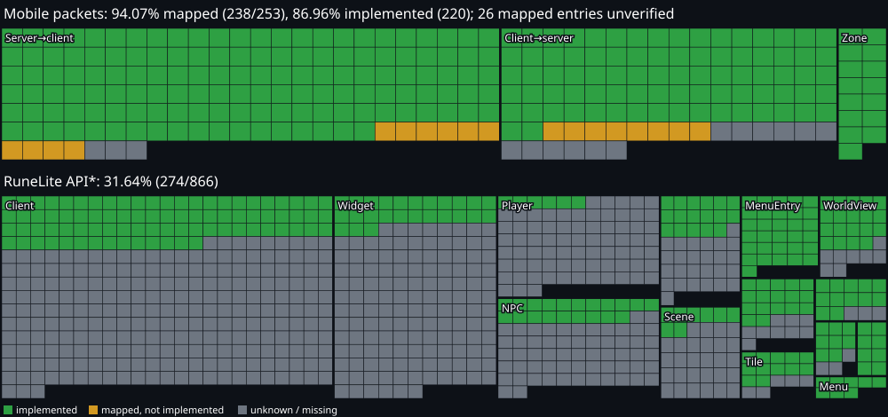

# osrs-plugins-reverse

RuneLite plugins on the official Old School RuneScape Android app. Inspired by
[AnyPS5](https://github.com/boykopovar/AnyPS5): no emulator and no rewritten client. The real
Android build (241.4) is repacked to load `libosrsrl.so`, which hooks the native game
(`liblibs.hal.system.osclient.so`), reads its state, and runs an in-process Java plugin host. That
host loads unmodified RuneLite plugins on ART. The target plugin is **Quest Helper**.

Development runs against a rev-241 test server (`server/`) that speaks the Android game protocol.
That protocol differs from the desktop one, and no public mapping of it exists. Nobody needs a Jagex
account: the server is also the local sign-in provider.

## Status

<!-- progress:start -->
  

- **Mobile packets mapped**: 241/253 (95.3%)
- **Live packets mapped**: 241/241 (100.0%)
- **Mobile packets mapped, verified**: 218/253 (86.2%)
- **Mobile packets implemented**: 222/253 (87.7%)
- **Server→client mapped**: 148/151 (98.0%)
- **Client→server mapped**: 93/102 (91.2%)
- **Zone sub-prots implemented**: 15/15 (100.0%)
- **RuneLite API implemented**: 404/866 (46.7%)

\* RuneLite API: abstract methods of the API interfaces the plugin host backs so far, not of the whole RuneLite API. Mobile packets count the opcodes in the client's own size tables.

Details: [docs/progress.md](docs/progress.md) (as of 2026-10-16, `36687d0+`).
<!-- progress:end -->

Milestones:
- [x] Repacked APK loads the hook library; ImGui overlay; game-thread hook (`doCycle`)
- [x] Test server: JS5, login, Lumbridge, walking, chat, inventory/equipment, NPCs, bank, dialogues
- [x] Plugin host on ART: events, varps/varbits, players/NPCs, widgets, overlays via Graphics2D shim
- [x] Server: collision + pathfinding, melee combat, journal tab, Cook's Assistant end to end
- [x] Quest Helper (real Plugin Hub jar) runs: native sidebar, quest list, step overlay
- [x] Menu entries: MenuOpened / MenuOptionClicked with decoded params, verified on device
- [x] **First full quest with Quest Helper on Android: Cook's Assistant** (dialogue start, step overlay
  follows the items, NPC highlight, hand-in, completion), 2026-10-15
- [x] Quest Helper sidebar search (Android text dialog → Swing document), NPC highlights and arrows
- [x] Test server: per-account saves (position, quest vars, items, bank, skills) that survive restarts
- [ ] Quest Helper complete: inventory/object/ground-item highlights, minimap arrows
- [x] **Second full quest with Quest Helper: Sheep Shearer** (object highlights and arrows on stairs
  and spinning wheel, minimap arrows, item counts, multi-floor route, hand-in, completion), 2026-10-16
- [x] **Third full quest with Quest Helper: Romeo & Juliet** (multi-NPC route across Varrock,
  dialogue-option highlights, item requirements turning green, completion), 2026-10-16
- [x] OpenRune-Server port: Android client in game; Cook's Assistant, Sheep Shearer and Romeo & Juliet
  pass end to end with Quest Helper on it (`openrune/`, `docs/openrune-port.md`), 2026-10-16
- [ ] Switch the default test server to OpenRune
- [ ] Multi-client: desktop RuneLite (via RSProx) and the Android client on the same server
- [x] **Protocol: every live Android opcode mapped** (241/241; 12 opcodes have no sender or no-op handlers in the client and are tagged dead), 2026-10-15
- [ ] Protocol: verify the remaining `// unverified` entries live
- [x] **Second plugin: Ground Items** (core RuneLite; item labels with prices, MenuEntryAdded and
  menu text written back into the game menu), 2026-10-16
- [ ] More plugins (GPU/region-dependent ones excluded)

## Layout

| Path | What | Owner | Notes |
|---|---|---|---|
| `native/` | `libosrsrl.so`: hooks, game accessors, JNI bridge, overlay | client dev | `docs/client-handoff.md`, `docs/offsets.md` |
| `host/` | Java plugin host (RuneLite API on the Android game) | client dev | `docs/plugin-host.md` |
| `server/` | Kotlin RSPS + Android codecs (`server/rsprot.patch` over RSProt) | server dev | `docs/server-handoff.md`, `docs/android-protocol.md` |
| `tools/` | repack/patch scripts, Ghidra helpers, memory agent, `progress.py` | shared | |
| `re/` | git-ignored inputs/outputs (APK libs, Ghidra project, jars, builds) | | |

## Progress tracking

`tools/progress.py` recomputes every number above from the code: the Android prot enums and
codec bindings (against the client's opcode size tables) and the RuneLite API methods the host
actually overrides (against its generated throwing stubs). It rewrites `docs/progress.md`, this
status block, and one row per day in `docs/progress-history.csv`. Run it before each milestone
commit (it needs `server/rsprot` from `server/scripts/rsprot.sh init` and `host/build.sh` output).

## Disclaimer

This is for research and interoperability. It distributes no Jagex code or assets. APKs, the game
cache and decompiled output stay out of git. Use the official servers only with the unmodified
app.

🦉
