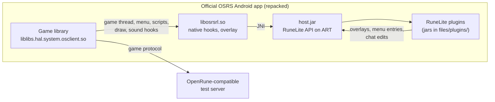

# osrs-plugins-reverse

RuneLite plugins running inside the official Old School RuneScape Android app, against a test server.

The project repacks the official Android client (build 241.4) so that it loads a native hook library,
`libosrsrl.so`. The library hooks the game's own native code, reads the game state, and starts a Java plugin host
inside the same process. The host implements a subset of the RuneLite client API on Android's runtime (ART), so
RuneLite plugins that were written for the desktop client run on the phone without changes. There is no emulated
desktop client and no rewritten game client: the plugins draw on, and read from, the real Android game.

> **Read the [Legal and safety](#legal-and-safety) section before you install anything.** This is a research and
> interoperability project. It is built for an OpenRune-compatible **test server**, it is not for Jagex's live servers,
> and it is not affiliated with or endorsed by Jagex or RuneLite.

## Contents

- [What works today](#what-works-today)
- [How it works](#how-it-works)
- [Requirements and install](#requirements-and-install)
- [What this is not](#what-this-is-not)
- [Legal and safety](#legal-and-safety)
- [Status and roadmap](#status-and-roadmap)
- [Building from source](#building-from-source)
- [Contributing](#contributing)
- [Licences and credits](#licences-and-credits)

## What works today

Numbers are produced by `tools/progress.py` from the code (the protocol enums, the RuneLite API methods the host
overrides, and the status tables in [docs/plugin-host.md](docs/plugin-host.md)); nothing here is hand-written.
The block below was last regenerated on 2026-10-24.

<!-- progress:start -->
    

[](docs/progress.md)

- **Mobile packets mapped**: 240/253 (94.9%)
- **Live packets mapped**: 240/240 (100.0%)
- **Mobile packets mapped, verified**: 239/253 (94.5%)
- **Mobile packets implemented**: 233/253 (92.1%)
- **Server→client mapped**: 147/151 (97.4%)
- **Client→server mapped**: 93/102 (91.2%)
- **Zone sub-prots implemented**: 15/15 (100.0%)
- **RuneLite API implemented**: 661/866 (76.3%)
- **Plugins running on Android**: 89/90 (98.9%)
- **Plugin Hub plugins running**: 85/110 (77.3%)

\* RuneLite API: abstract methods of the API interfaces the plugin host backs so far, not of the whole RuneLite API. Mobile packets count the opcodes in the client's own size tables.

Details: [docs/progress.md](docs/progress.md) (as of 2026-10-24, `bce8d50+`).
<!-- progress:end -->

What these numbers mean:

- **Plugins running on Android: 89/90.** The 90 are the core RuneLite plugins tracked in the "Core plugin status"
  table of [docs/plugin-host.md](docs/plugin-host.md). 89 rows say `runs` (the plugin did its job on a device
  against the test server); one, World Hopper, only `starts`. Most rows were checked one by one in October 2026 and
  each row names what was observed. The newest release gate did not repeat every row (see Status).
- **Plugin Hub plugins running: 85/110.** The same measure for third-party plugins from RuneLite's Plugin Hub
  that the project builds from pinned source (the "Plugin Hub status" table; 25 more start but were not exercised).
  The pins are listed in [host/plugins/hub/plugins.txt](host/plugins/hub/plugins.txt).
- **Mobile packets.** The Android game protocol differs from the desktop one and has no public mapping. The 253
  is the number of opcodes in the Android client's own size tables; 240 are mapped, 233 have a codec in the test
  server's Android protocol module. This describes the server side of the project, not the app.
- **RuneLite API: 661/866.** The percentage is of the API interfaces the host backs so far, not of the whole
  RuneLite API.

### What was observed on a device

Each line below was watched on an Android client against the OpenRune test server. The records are in the
maintainer's evidence folders (`re/evidence/<change>/`, git-ignored, so not in this repository) and, for the
older plugin checks, in the dated rows of [docs/plugin-host.md](docs/plugin-host.md).

| What | Observed | Where recorded |
|---|---|---|
| **Quest Helper** (real Plugin Hub jar) | Three full quests completed with its sidebar, step overlay, NPC and object highlights, minimap arrows and item requirements: Cook's Assistant (2026-10-15), Sheep Shearer and Romeo & Juliet (2026-10-16) | docs/plugin-host.md row "Quest Helper"; docs/client-handoff.md |
| **Ground Items** | Item labels with prices; menu recolouring | docs/plugin-host.md row "Ground Items" |
| **Ground item despawn timers** | A dropped tradeable item reported `visible in 99, despawn in 299` ticks and left the scene exactly on its despawn tick (0 ticks late); a dropped easy clue reported `despawn in 6099 ticks, private`. Known gap: after a relog the server re-sends the player's own drops without a despawn time, so the timer is wrong until that is fixed server side | `re/evidence/hub-ground-items-despawn` (2026-10-21) |
| **Clue Steps** (Plugin Hub) | Reads the step count from the server's "Check steps" message and stores it (`You have completed 2 steps on this easy clue scroll.` gave `clueEasy=2`). The text the plugin draws on the clue was not read back | `re/evidence/hub-clue-steps-tier` (2026-10-21) |
| **Clue Juggling Timers** (Plugin Hub) | Its InfoBox counted a dropped clue down minute by minute and kept counting across a relog | `re/evidence/hub-ground-items-despawn` |
| **Common core plugins** | Opponent Information, Boosts Information, XP Drop, Status Bars, XP Tracker, Loot Tracker, Slayer, Bank, Fishing, Woodcutting, Time Tracking, Ground Markers, NPC Indicators, Inventory Tags, Item Charges, Chat Filter and others each have a `runs` row with what was seen (2026-10-16 and 2026-10-17) | docs/plugin-host.md "Core plugin status" |
| **Release gate** | On 2026-10-24 a build was installed fresh on an Android Studio emulator (x86_64 with arm64 translation) and signed in; the host started Ground Items, Opponent Information, Quest Helper and the developer tools, and Clue Steps when it was added; the player walked, teleported, spawned and dropped items, and logged back in after a force-stop | `re/evidence/rel-20261024-1/client-record.md` |
| **Single APK** | One universal APK (arm64 native libraries) installed with one `adb install`, loaded the hooks and the host, and reached the logged-in state on an emulator. The default plugins were not exercised in that check | `re/evidence/client-single-apk` |

Not observed, so not claimed: every other plugin on every release, performance on a real phone, or anything on a
server other than the project's test server.

Screenshots and a demo video are not in the repository yet. The plan for the video is kept with the maintainer's
notes; the clips and images will be added here, as real files under `docs/media/`, once they have been recorded.

## How it works



1. **Repack** (`tools/repack.sh`). The official base APK and arm64 split are decoded, the app is made to load
   `libosrsrl.so` right after the game's library, the telemetry switches are applied (see below), and for a test
   server build the game's config URL, game port and login key are pointed at the test server. The result is one
   signed universal APK (`re/out/osrs-runelite.apk`).
2. **Native library** (`native/`, `libosrsrl.so`). It installs hooks on the game's native code (a GOT hook on the
   graphics swap, and inline hooks on the game thread's cycle, the menu, scripts and sound), reads the game's own
   data structures at offsets documented in [docs/offsets.md](docs/offsets.md), draws a small Dear ImGui overlay (an
   `RL` button that opens a plugin side panel, and a virtual Shift key), and carries `host.jar` inside itself.
3. **Plugin host** (`host/`, `host.jar`). A Java implementation of the parts of RuneLite's `Client` API that
   plugins use, backed by the native library: events, varps and varbits, players, NPCs, scene items, widgets, menus,
   overlays (through a `java.awt` Graphics2D shim), config, sounds and the Swing panels that plugins add to
   RuneLite's side bar (rendered by the overlay). It embeds a subset of the RuneLite client 1.13.1 so the core plugins
   come with it. Details: [docs/plugin-host.md](docs/plugin-host.md).
4. **Plugins.** The host loads plugin jars from `files/plugins/` in the app's data folder. Core plugins need only a
   small descriptor jar (`tools/dex-plugin.sh --core`); Plugin Hub plugins are built from pinned source with
   `host/plugins/hub/build.sh` and converted with `tools/dex-plugin.sh`.

**Privacy patches.** The official app ships analytics and consent SDKs. Every build of this project goes through
`tools/patch_telemetry.py`, which prints seven `telemetry:` lines when it applies: it stops the Singular attribution
SDK from starting, disables the consent-sync request to Jagex's account service, turns off Firebase Analytics and
Crashlytics collection in the manifest, and blanks the consent-sync, group-score and web-link hosts. A network review
on 2026-10-24 found these remote addresses for the app: the test server, `api.runelite.net` and `static.runelite.net`
(prices and NPC data fetched by plugins), Braze, OneTrust and Google (push and consent services of the official app,
which are not switched off), and no Jagex or RuneScape address. That review could not read the emulator's DNS log; it
did record that the game's own lookups were only the test server. Plugins you add can make their own requests: the
host's network guard only refuses requests that would write to a remote service, and a plugin such as Hiscore, for
example, queries the public hiscores when you use it. The full analysis is in
[docs/app-telemetry.md](docs/app-telemetry.md).

A developer tool, OpenRune-Developer-Tools, can be loaded as a plugin. It lets a program drive the client over an
adb tunnel (off by default, loopback only, behind a token). It exists to test this project and should not be
installed for play.

## Requirements and install

**Download.** The release page is [releases/latest](https://github.com/AlexPerrin/osrs-plugins-reverse/releases/latest).
A release of this project carries two files and the sha256 of each in its notes: **one universal APK** and
`THIRD_PARTY_NOTICES.md`. Check the APK against the sha256 on the release page before you install it. At the time of
writing the newest published release, `v0.1.1`, lists no files and `v0.1.0` lists the older two-file split APK; a
release that attaches the single APK is planned (see [Status and roadmap](#status-and-roadmap)). Until the release
you open lists one APK, build it yourself (see [Building from source](#building-from-source)).

**What the APK is.** It is Jagex's Old School RuneScape Android app (build 241.4), repacked by this project: the
official app's code, resources and game library are inside it, next to this project's native library
(`libosrsrl.so`), its plugin host (`host.jar`) and the licence notices (also embedded as
`assets/THIRD_PARTY_NOTICES.md`). The Jagex content in it is not covered by this project's licence (see
Legal and safety below). The release ships no plugins.

Requirements:

- **A 64-bit ARM Android environment (arm64-v8a only).** The native library is arm64-v8a only: a 64-bit ARM phone or an
  emulator with ARM translation. Development and release-gate device: the
  Android Studio emulator (AVD `Agent_Phone`: Medium Phone profile, x86_64 API 37 image with arm64 translation). A real
  phone has not been tested.
- **An OpenRune-compatible test server** that speaks the Android (revision 241) protocol and a local sign-in
  provider. The one used in development is OpenRune-Server with this project's Android support (the fork's
  `local/server-tools` branch); upstream OpenRune does not provide the Android protocol on its own. The APK from a
  test server build points the game at `10.0.2.2:43594` (game) and `10.0.2.2:8080` (config), which is the Android
  emulator's alias for the host machine's loopback; on a phone or another address the config host has to be set at
  repack time (`SERVER=`), so build it yourself. The APK cannot sign in to Jagex: the test server is also the sign-in
  provider ("Sign in with Email / Username"), and no Jagex account is needed.
- **The official app uninstalled first.** The APK has the same package name as the official app
  (`com.jagex.oldscape.android`) but a different signing key, so Android refuses to install it over the official app
  (`INSTALL_FAILED_UPDATE_INCOMPATIBLE`, observed on 2026-10-24). Uninstall the official app first; **its data is
  deleted** with it. Installing this APK replaces the official app on that device.

Install, with one `adb` command (or sideload the same file by any other means):

```
adb install osrs-runelite.apk
```

(Use the file name from the release page; a locally built APK is `re/out/osrs-runelite.apk`.)

**Plugins.** The APK alone loads no plugins. The host loads plugin jars from
`/sdcard/Android/data/com.jagex.oldscape.android/files/plugins/` on the device, and no release attaches any jar. Build
the jars you want (see [Building from source](#building-from-source)), push them there with `adb push`, restart the
app, and sign in. Plugin Hub plugins keep their authors' licences, listed under Licences and credits below.

**Demo video.** Coming. It is not recorded yet and nothing here links to it.

## What this is not

- **Not a way to play on Jagex's servers.** It is built for a private test server. See the legal section.
- **Not RuneLite.** It is not the RuneLite client and it is not made or supported by the RuneLite team. It runs
  RuneLite's plugin code against a re-implementation of part of RuneLite's API.
- **Not complete.** About three quarters of the API interfaces it backs are implemented, and the GPU plugin and 117 HD
  do not run (both are feasibility studies only).
- **Not a product.** There is no installer, no update channel and no support, and any build can break
  when the game updates. The offsets are specific to build 241.4.
- **Not a Jagex mod or a tool that the game accepts.** It changes the official app. Nothing here is approved by
  Jagex.
- **Not a complete test server.** Content on the server side is partial, and the plugin results above were seen on
  that server, not on the live game.

## Legal and safety

- **No affiliation.** This project is not affiliated with, endorsed by, sponsored by or approved by Jagex Ltd or by
  RuneLite or its maintainers.
- **Trademarks.** Old School RuneScape and RuneScape are trademarks of Jagex Ltd; the trademarks and the app
  are Jagex's. RuneLite is the name of an independent open source project. The names are used here only to say what
  this project works with.
- **What the licence covers, and what it does not.** This repository's own code (`native/`, `host/`, `tools/`) is
  under the ISC licence ([LICENSE](LICENSE)). The repository does not contain Jagex's app. **The APK that the release
  ships does**: it contains Jagex's Old School RuneScape app (its code, resources and the game library) plus our
  additions. That app and its content are Jagex's property and **are not covered** by this project's ISC licence, by
  the licences listed in [THIRD_PARTY_NOTICES.md](THIRD_PARTY_NOTICES.md), or by anything else in this repository;
  nothing here grants any right to them. The notices file says the same. Whether that content may be redistributed
  is a question for Jagex's terms, not something this project can grant, and this project does not claim that it
  may.
- **Use on Jagex's servers is not what this is for, and it may break their rules.** The build connects to a test
  server, not to Jagex. Jagex's rules restrict third-party clients and modifications of its app, and a modified
  client logging in to an official server can put the account at risk, up to a ban. This project does not
  test, try or support that, makes no statement about which modifications Jagex accepts, and takes no
  responsibility for what happens to an account that is used with it. Do not use it with an account you care about.
- **No claim of safety or approval.** Nothing here is certified, audited or approved by anyone, and there is no
  claim that it is safe, undetectable or ban-proof. It is software that modifies a game client, shared as research.
- **What the build does on the network.** The repack points the game at the test server and switches off the
  attribution and analytics SDKs listed above, but it does not make the app silent: the official app's consent,
  push and engagement services and the hosts that plugins use are described under [How it works](#how-it-works) and
  in [docs/app-telemetry.md](docs/app-telemetry.md). Read them before you decide to use it.
- **The test server login is not your Jagex login.** The test server's local sign-in accepts a fixed test
  account. Never enter real credentials into a build of this project.
- **Warranty.** The code is provided as is, without warranty (see [LICENSE](LICENSE)).

## Status and roadmap

Done, with the dated checks in [docs/client-state.md](docs/client-state.md):

- [x] Repacked app loads the hook library, overlay and game-thread hook
- [x] Plugin host on ART: events, vars, entities, widgets, overlays through a Graphics2D shim, menus, config, audio
- [x] Quest Helper (real Plugin Hub jar): Cook's Assistant, Sheep Shearer and Romeo & Juliet on the test server
- [x] 89 of the 90 tracked core plugins run; 85 of 110 tracked Plugin Hub plugins run (see the numbers above)
- [x] Every live Android opcode mapped (240/240) and 239 verified against the client's own readers and senders
- [x] Privacy patches in every build, with a network review per release
- [x] One universal APK as the build output (merged; no release has attached it yet)
- [x] Release gates PASS for v0.1.0 and v0.1.1 (records in `qa/`); the gate of 2026-10-24 ran on an emulator, did not
  repeat the full plugin regression, and has no release attached

Next (nothing here is promised for a date):

- [ ] A release that attaches the single APK and the notices file
- [ ] The remaining plugins (region-dependent ones excluded), the camera and animation setters, the WorldEntity API
- [ ] Known gaps: the chat Enter key stalls after the soft keyboard has been shown once (game side); the ground item
  timer after a relog depends on a server fix; the Current World plugin's world switcher is unchecked
- [ ] Feasibility studies only: RuneLite's GPU plugin and 117 HD on Android

## Building from source

The build needs, besides this repository:

- Official OSRS Android 241.4 `base.apk` and `split_config.arm64_v8a.apk` in the repository root (not provided)
- JDK, `apktool` (`~/tools/apktool.jar`), Python 3
- Android SDK with platform `android-37.0` and build-tools 36.0.0 (`d8`), and NDK r27d with CMake and Ninja
- RuneLite 1.13.1 `runelite-api` and `client` jars plus the client's runtime dependencies in `re/runelite/`
  (inputs and versions are listed at the top of [host/build.sh](host/build.sh) and in
  [THIRD_PARTY_NOTICES.md](THIRD_PARTY_NOTICES.md))
- A debug signing key at `re/debug.keystore`
- For a test server build: the test server's login key (`MODULUS`) from the server tooling (`SERVER_TOOLS`)

```
host/build.sh                                  # Java host -> re/host/host.jar
cmake -S native -B re/build -G Ninja \
      -DCMAKE_TOOLCHAIN_FILE=<ndk>/build/cmake/android.toolchain.cmake \
      -DANDROID_ABI=arm64-v8a -DANDROID_PLATFORM=android-26 -DCMAKE_BUILD_TYPE=Release   # once
ninja -C re/build                              # libosrsrl.so (embeds host.jar)
OPENRUNE=1 LOCAL_AUTH=1 tools/repack.sh        # re/out/osrs-runelite.apk; expect 7 "telemetry:" lines
tools/dex-plugin.sh --core grounditems re/host/plugins/grounditems.jar   # a core plugin descriptor jar
host/plugins/hub/build.sh clue-steps           # a pinned Plugin Hub plugin -> re/host/plugins-extra/hub-clue-steps.jar
```

`re/` (inputs, builds, jars) is git-ignored. Offsets for build 241.4 are in [docs/offsets.md](docs/offsets.md) and the
protocol notes in [docs/android-protocol.md](docs/android-protocol.md). Any change that touches networking should be
read against [docs/app-telemetry.md](docs/app-telemetry.md) first.

## Contributing

Issues and pull requests are welcome, with these expectations:

- This repository is the client only. Server code belongs to the OpenRune fork and to upstream OpenRune.
- Keep changes small and say how you checked them. A claim that something works should come with the log lines or
  the data you read (chat history, game variables, the host's log), not a screenshot alone.
- Do not add Jagex's files, game cache, APKs or decompiled output to the repository, and do not add anything that
  contacts Jagex.
- Adding a library or a native component means updating [THIRD_PARTY_NOTICES.md](THIRD_PARTY_NOTICES.md).
- Start with [docs/client-state.md](docs/client-state.md) (the current state) and [docs/plugin-host.md](docs/plugin-host.md).

## Licences and credits

- **This project's code**: ISC, Copyright (c) 2026 Alex Perrin ([LICENSE](LICENSE)).
- **Third-party code inside the build** (Dear ImGui and stb, LLVM libc++, RuneLite client and API 1.13.1, Guice, Guava,
  Gson, OkHttp, Okio, Apache Commons, protobuf-lite, SLF4J and others): listed with versions, copyright notices
  and licence texts in [THIRD_PARTY_NOTICES.md](THIRD_PARTY_NOTICES.md). The notices file is also embedded in the APK
  as `assets/THIRD_PARTY_NOTICES.md`.
- **RuneLite** is BSD 2-Clause, Copyright (c) 2018 Adam and the RuneLite contributors. Some of its resources
  (fonts, shaders) carry other licences, which the notices file lists.
- **Plugin Hub plugins** keep their authors' own licences; each plugin's jar includes its LICENSE, and the pins in
  [host/plugins/hub/plugins.txt](host/plugins/hub/plugins.txt) point at each plugin's source repository. Plugin
  authors own their plugins; this project only builds and runs them.
- **Jagex's app** is not covered by any licence in this repository (see [Legal and safety](#legal-and-safety)).
- **Credits**: the RuneLite project and its contributors; [OpenRune](https://github.com/OpenRune/OpenRune-Server) for
  the server this is tested against; RSProt, the protocol library the test server's Android support extends;
  [AnyPS5](https://github.com/boykopovar/AnyPS5) for the idea of hooking a real native client instead of rewriting it.
