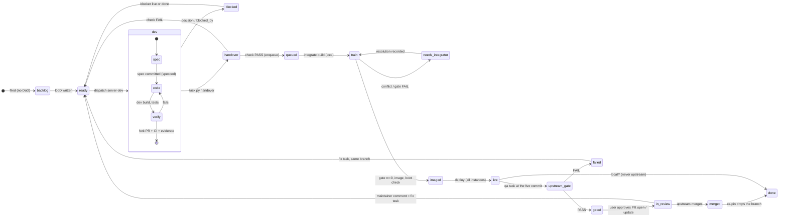
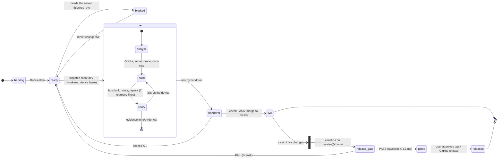
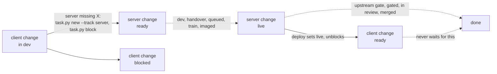
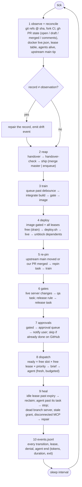
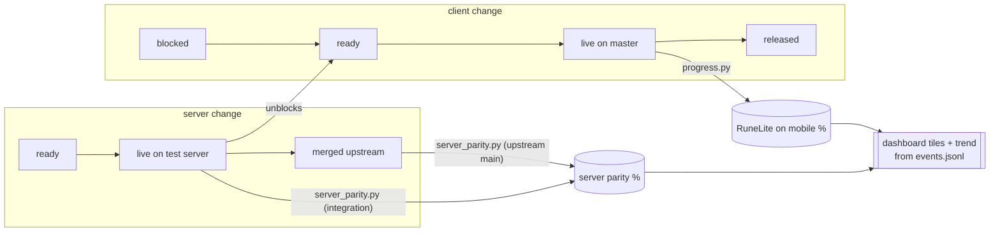

# Harness v3: the problem, first principles and the process model

Written 2026-10-20 (v3 architect session) for the session that builds harness v3. It belongs to the v3 handoff
(docs/harness-v3-handoff.md reads with it) and answers three questions before any code: what is the harness for,
what must it guarantee, and what does the loop look like as a state machine. Sources: HANDOFF.md,
docs/harness-v3-handoff.md, docs/workflow.md, docs/harness.md, docs/integration-pipeline.md,
re/evidence/harness-v2-review/ and the task store at hand-off.

## 1. The goal: what the harness exists to move

Two products, one measurable goal each. **Progress is counted only on a live target.** Everything between a
backlog entry and the live target is inventory, and the harness's whole job is to move inventory through the
loop faster, with less human and orchestrator time, without losing accuracy or privacy.

| Track | Goal | Measured by | Live target | At hand-off |
|---|---|---|---|---|
| Client | **RuneLite on mobile**: every RuneLite plugin (core first, then the user's own hub plugins, then the Plugin Hub) runs in the official OSRS Android app as it does on desktop, and the app never contacts Jagex | `tools/progress.py`: RuneLite API implemented, core plugins running, hub plugins running, packets mapped; A/B parity for drawing; Network QA | `master` (dev's check), then a tagged `vX.Y.Z` (release gate) | API 661/866, core 89/90, hub 84/109 (the user's 22/25), packets 240/253 |
| Server | **A clone of the official OSRS server**: 100% = identical behaviour, built as upstream OpenRune contributions and run on our test server | the server parity metric (task `server-parity-metric`: OSRS content from cache and wiki vs the integration tree, and vs upstream `main`) | the live test server (`integration` at a pin), then upstream `main` | not measured; 17 of our PRs merged, 7 open, 2 drafts |

The two are coupled: a plugin verified against a server that behaves wrongly is not verified, so server parity is
on the client's critical path (blocker edges), and upstream contribution keeps the test server on current `main`
instead of a diverging patch set. The user's standing priority order inside the client goal is the user's own
plugins first, then the ranking; GPU and 117 HD are separate stretch goals, never excluded.

**SMART check.** Specific and measurable: yes, both metrics are computed from source. Achievable: per change,
yes; the whole goal is a horizon. Relevant: both metrics are what the user calls progress (task counts are
throughput only). Time-bound: **no date has been set.** v3 reports rates (changes live per day, metric delta per
week) so a date can be forecast; the target date is an open user decision (section 7).

## 2. First principles

These are the invariants the loop is designed around. Each one is a rule v2 learned by breaking it
(docs/harness-v3-handoff.md section 5c), restated as a principle the v3 design derives from.

1. **Progress is a live target, not a branch.** A server change counts when the live test server runs it and,
   finally, when upstream `main` carries it; a client change when `master` carries it. `shipped` is inventory.
2. **One change, one identity, one lifecycle.** A change is a slug; its branch, spec, PR text, gate records, pin,
   live commit and upstream PR hang off that slug. Tasks are the stages of a change, generated by the driver,
   never hand-linked. (Today: three or four branches per feature and nothing tying them together.)
3. **Observed facts are the truth; the record is a cache.** A change's stage is derivable from git refs at a sha,
   CI conclusions, PR state, the image record, `live.json` and the lease table. When record and observation
   disagree, the observation wins and the driver repairs the record. (Today: stale approvals, stale tasks,
   leftover grants, `shipped` read as deployed.)
4. **Generator and evaluator are separate, and the evaluator is concrete.** A dev claims; a deterministic check
   passes only on evidence that exists; an independent LLM evaluator (QA) runs only at the two outward gates.
5. **Humans sit only at the outward boundaries.** Upstream actions (OpenRune/*) and client releases wait for the
   user; nothing else may prompt. A prompt anywhere else is a defect with a test.
6. **Shared resources are leased, not assumed.** One Android device, two desktops, two gate and two dev build
   slots, one integration branch, one live server, one Ghidra writer. A lease has a holder, a purpose, an attached
   process, a heartbeat and an expiry; idle holds are reclaimed with evidence. The same lease gates the tools that
   touch the resource (the devtools bridge, `desktop.sh`, deploy).
7. **The official game is the accuracy baseline.** RSProx recordings beat the wiki, the wiki beats the cache;
   every divergence is a caveat in the spec and the PR text, never silent.
8. **Privacy invariants are hard constraints.** No client contacts Jagex; every APK goes through the telemetry
   patch; the user's own RuneLite is never read; the tester account is never emptied.
9. **Scripts do anything repeatable; agents do judgement.** Analysis, code, accuracy, conflict resolution and gate
   verdicts need a model. Checks, merges, trains, gates, images, deploys, re-pins and bookkeeping do not. An agent
   is a transition executor with a task, a budget and an exit.
10. **State on disk, events append-only, sessions disposable.** A fresh session resumes from the store and the
    event log in one command; nothing lives only in chat or memory.
11. **Policy is data.** Who may push where, what needs approval, which instances a role may use, the exit and
    screenshot rules: one versioned file read by hooks, briefs and the driver, with a test per past incident.
12. **Throughput is the critical chain.** The loop is as fast as the longest wait a ready change spends on a
    resource, a check, a build, a deploy or a human. Stall time is the number to drive to zero.

## 3. The model

### 3a. Entities

| Entity | Is | Keyed by | Where it lives (v2 today, v3 target) |
|---|---|---|---|
| Change | one feature or fix on one branch, with one lifecycle (section 3b) | slug (`fix/<slug>`, `content/<slug>`, `local/<slug>`, `client/<topic>`) | spread over tasks and branches; v3: a change record |
| Task | one stage of a change, with a definition of done, an owner, granted instances, evidence | task id | `harness/tasks/<id>.md` (keep) |
| Agent | the executor of one transition that needs judgement: `client-dev`, `client-qa`, `server-dev`, `server-qa`, `integrator` (v3) | agent name (`sd28`) | `.claude/agents/*.md`, runs under `re/harness/runs/` |
| Driver | the executor of every transition that does not: observe, check, ship, train, gate, image, deploy, unblock, dispatch, heal, log | one process | `tools/harness/orchestrate.py run` (never used for real in v2) |
| Orchestrator | the main session: decisions, exceptions, relaying the user's approvals | one session | chat; v3: reads the dashboard, writes decisions |
| Resource / lease | a finite thing a transition needs (section 3e) | instance or slot name | `device-lock.sh`, `buildq.sh`, `integrate.py` lock; v3: one lease service |
| Target | where a change becomes live: `master`, `integration` at a pin, the live server, upstream `main`, a release tag | ref or image id | git, docker, GitHub |
| Gate | a check with a verdict against an exact commit: the hand-over check, a train gate, the upstream gate, the release gate | commit | `handover-check.sh`, `qa.sh gate`, QA records on the fork's `docs` branch, `qa/client-X.Y.Z.md` |
| Event | one state change with UTC time, change, task, agent, from, to, commit, cost | append order | v3: `events.jsonl` |
| Policy | the rules hooks, briefs and the driver enforce | version | v3: one file |
| External system | whatever holds truth the harness does not own: the fork, OpenRune upstream, fork CI, BlueStacks, the desktop clients, the live server, the OSRS Wiki and cache | n/a | GitHub, docker, adb, MCP servers |

### 3b. The lifecycle of a server change

The target model from docs/harness-v3-handoff.md section 7b, drawn as the states the driver advances. Solid
edges are the happy path; dashed edges are failures and re-entries. Every edge is a transition in table 3d.

Rules the graph encodes:
- **A new commit re-enters at `ready`.** Rewrites, gate fixes, merges from `main` and review fixes are commits on
  the same branch; each voids the gates above it and needs the dev's evidence again. No new branch names.
- **Gate only what is live.** The upstream gate runs on the commit the live server runs (integration carries it
  at its pin), so "gate PASS" means "what we tested is what we send".
- **`live` unblocks the client**, not `queued` or `train`: a client task blocked by this change goes back to
  `ready` on the deploy (`live`), never earlier.
- **`merged` is not the end.** The next re-pin drops the branch from `integration` and moves the fork's `main`;
  until then the live server carries both.

### 3c. The lifecycle of a client change, and the cross-track edge

The cross-track edge is the only place the two machines touch, and it is an edge in the store, not prose:

### 3d. Transitions: who, which tool, what it depends on

The tool column is what runs today (v2) unless marked v3. "Needs" is the dependency the driver must see hold
before it fires the transition; every item in that column is observable, which is what makes principle 3 possible.

**Server track**

| Transition | Who | Tool | Needs (observable) | Resource |
|---|---|---|---|---|
| backlog → ready | orchestrator or user | `task.py new --server-dod` | a definition of done | none |
| ready → dev | driver | `orchestrate.py dispatch` → `Agent(server-dev)` with `task.py brief` | a free server slot (max 2), no open blocker | dev build slot; desktop lease granted (`reuse`) |
| dev: spec | server-dev | `accuracy-check` (osrs-mcp `wiki_page`, `wiki_npc_spawns`, `cache_search`, `gameval_search`; RSProx under `re/ref/rsprox/`); `gh pr list -R OpenRune/...` for overlap | none | none |
| dev: build and verify | server-dev | `build-test` (`buildq.sh` dev lane, `qa.sh dev`), `git push fork` + fork PR (`tools/fork.sh`), `ab-test` on a branch server (`osrs-devtools-desktop`), `server-probe`, `fix_gameval_conflicts.py` | the warm container, the branch server up | dev slot; desktop lease while in use |
| dev → handover | server-dev | `task.py handover --branch --commit --pr --ci --evidence` | DoD all `[x]`, branch at the sha on the fork, spec on `docs`, PR text on `docs` | none |
| handover → queued or ready | driver (`reap`) | `handover-check.sh` then `ship.sh` → `integrate.py enqueue` | fork CI `success` at exactly the sha; spec file named by slug; evidence dir non-empty | none |
| queued → train | driver | `integrate.py build` → `build-integration.sh` at the pins, lease push of `integration` | oldest entry past the debounce; pins consistent | integration lock |
| train → needs_integrator | driver | the train's stop output | an unrecorded conflict, a gameval clash, a superseded branch | integration lock held |
| needs_integrator → train | integrator (v3) | records a resolution (rerere / drop a branch), never pushes `integration` | a brief from the change record and the stop output | integration lock |
| train → imaged | driver | `qa.sh clone` + `qa.sh gate` (gate slot), `image.sh` (v3: cache fixes, `COPY --from` the live image for keys, key-hash match, private boot check) | gate `rc=0` at the integration commit; "Server ready in" | gate build slot (5 GB) |
| imaged → live | driver | `deploy.sh` (v3): rollback tag, retag, `compose up -d --no-deps openrune`, wait for ready, auto-rollback | image record; **all three instance leases**; the live server | device + desktop + desktop2 |
| live → (unblock) | driver | `task.py` unblock on `live` | the deploy event | none |
| live → upstream_gate | driver | `qa-<id>` task → `Agent(server-qa)` | the live server carries the commit (pin = commit) | desktop lease |
| upstream_gate → gated or failed | server-qa | `accuracy-check` (independent), in-game re-check, `pr-text-review`, CI at the sha, one change, on current `main`, `fix_gameval_conflicts.py --check`; record on the fork's `docs` | the record line `## Upstream gate: **PASS**` at the commit | desktop lease while in use |
| gated → in_review | user, run by the orchestrator | `gh pr create / ready / comment -R OpenRune/...` (`publish_gate.py` requires the record) | an approval filed and answered | the user |
| in_review → ready | driver (v3: `gh` timeline) | `task.py new` fix task on the same branch | a maintainer comment or review | none |
| in_review → merged → done | driver (v3: repin-check) | `fork.sh sync`, drop from `integration.txt`, next train | upstream `main` contains the commit | integration lock |

**Client track**

| Transition | Who | Tool | Needs (observable) | Resource |
|---|---|---|---|---|
| backlog → ready | orchestrator or user | `task.py new --dod` | a definition of done | none |
| ready ↔ blocked | client-dev (files it), driver (clears it) | `task.py new --track server`, `task.py block --by`; unblock on the server change's `live` | the server task's status | none |
| ready → dev | driver | `orchestrate.py dispatch` → `Agent(client-dev, isolation: worktree)`; symlinked `re/`, APKs, `openrune/src` | a free client slot (1 today), no open blocker | device lease granted (`reuse`) |
| dev: analyse | client-dev | `reverse` (headless Ghidra, `-readOnly`), `server-probe`, osrs-mcp | none | Ghidra writer only when updating the project |
| dev: build | client-dev | `host/build.sh`, `ninja -C re/build`, `tools/repack.sh` (fails without 7 `telemetry:` lines); hub `build.sh` with netcheck | none (no container) | none |
| dev: verify | client-dev | `device-test` (restore-check `pre`, `osrs-devtools` data tools, logcat, `check`), `network-qa` when traffic changes, `ab-test` for a parity claim | the device restored at the end of the slot (stop hook) | device lease while in use; desktop for A/B |
| dev → handover | client-dev | `task.py handover --branch --commit --evidence` | DoD `[x]`, `repack.log`, logcat or data dump, `netqa*.md` when `network: true` | none |
| handover → live or ready | driver (`reap`) | `handover-check.sh` then `ship.sh` (`--no-ff` into `master`, push `origin main`) | branch at the commit, not on `master` yet (docs-only: no device evidence) | none |
| live → release_gate | orchestrator (v3: driver on a release rule) | `release-vX.Y.Z` task → `Agent(client-qa)` | a set of live changes worth a release | device lease, desktop for A/B |
| release_gate → gated or ready | client-qa | full regression through the devtools bridge, Network QA, privacy patches in the build, `reverse` for native claims; `qa/client-X.Y.Z.md` | `## Verdict: **PASS**` for the commit | device + desktop leases while in use |
| gated → released | user, run by the orchestrator | `git tag`, `gh release create` (`publish_gate.py` requires the record), `tools/release-dev.sh` attaches the APK | an approval answered | the user |

### 3e. Resources and their contention

| Resource | Capacity | Used by | Contention the model must handle |
|---|---|---|---|
| Android device (BlueStacks) | 1 | client-dev verify, client-qa gate, **deploy** | **Priority inversion**: a deploy needs the device; the client dev holding it may be waiting for that deploy. Needs a drain: the driver stops granting, waits for the lease, deploys, re-grants |
| desktop, desktop2 | 2 | server-dev A/B, server-qa in-game check, **deploy** | an idle hold starves a gate; two agents on one bridge port (10-20) |
| gate build slots | 2 × 5 GB | train gates, `qa.sh gate` | memory guard; cold vs warm not recorded |
| dev build slots | 2 × 4 GB | server-dev warm containers | 45-minute idle stop |
| integration lock | 1 | trains, re-pins | a train blocks on a deploy that blocks on a lease |
| live server | 1 | deploy | all three instances at once; rollback tag first |
| fork CI | ~20 jobs | every fork push | none; the free resource, why CI is the build evidence |
| Ghidra project | 1 writer | `reverse` | `-readOnly` for everyone else |
| orchestrator context | 1 | every chat relay | the v2 bottleneck; v3 removes it from the loop |
| the user | 1, asynchronous | upstream actions, releases, decisions | approvals must queue and notify, never block other work |

### 3f. The loop as code: one driver tick

What `orchestrate.py run` must do each tick, in order. Steps 1, 5, 6, 9 and 10 are new in v3; 2, 3, 7 and 8
exist (phase 1); 4 is pipeline phases 2 and 3.

The orchestrator reads the dashboard built from step 10 and acts only on approvals, decisions
(`waiting-user`) and exceptions (`needs-agent`, repeated failures). The user acts only on approvals.

### 3g. How a tick moves the goal

Every edge in 3b and 3c that reaches `live`, `merged` or `released` is a metric recount. Nothing else moves the
tiles; everything else is throughput.

## 4. The problem v3 solves

Given

- the two tracks' changes, each at one stage of the lifecycle in 3b or 3c, with blocker edges between them;
- the shared resources of 3e with their capacities;
- the role agents, each with a cost in tokens and minutes;
- the external systems whose state is the truth (the fork, OpenRune upstream, fork CI, the device, the desktops,
  the live server),

build a driver that, every tick and without a chat turn:

1. **observes** external state and repairs the record when they disagree (principle 3);
2. **advances** every change whose next transition's dependencies hold, in priority order and within the leases
   (3d, 3e);
3. **spawns** the smallest executor for a transition that needs judgement, with a task, a budget and an exit, and
   stops it when its task leaves `in-progress` (principle 9);
4. **parks** only the two outward transitions on an asynchronous approval queue that notifies the user, while
   everything that does not depend on them keeps moving (principle 5);
5. **frees or reclaims** any resource held without use, and repairs lingering agents, dead containers, stale
   grants and disconnected bridges (principle 6);
6. **appends an event** for every transition, lease, denial and agent end, so that unattended hours, lead time,
   stall time, first-pass rates, cost per task and the two product metrics are measured from one log
   (principle 10).

The orchestrator shrinks to decisions and exceptions; the user to approvals and decisions. The user's three
priorities map onto this directly: **overnight runs** are steps 1 to 5 working for hours; the **dashboard** is
step 6 rendered; **self-healing** is steps 1 and 5.

### 4a. Where v2 breaks the model

| v2 finding (handoff 5c) | Principle broken | What the model says instead |
|---|---|---|
| 1 the orchestrator is the scheduler | 9, 12 | the driver tick (3f) executes every transition that needs no judgement |
| 2 rules don't persist | 11 | policy as data, read by hooks, briefs and the driver |
| 3 policy enforced by text matching | 3, 11 | resolve the target (remote URL, repo, branch, instance) and decide against the policy |
| 4 no model of shared resources | 6 | one lease service (3e), and the tools that touch a resource check the lease |
| 5 state drifts from reality | 3 | reconcile each tick: observation wins, record repaired, drift logged |
| 6 agent lifecycle unmanaged | 9 | an agent is one transition with a budget and an exit; cost attributed to the task |
| 7 expensive general agents do scripted work | 9 | trains, images, deploys, re-pins are scripts; the integrator is a small agent for exceptions |
| 8 the harness can't change itself safely | 11 | an allow-listed path for harness changes agreed with the user once (worktree, tests, merge) |
| 9 no measurement | 10, 12 | `events.jsonl` first, so v3 itself can be judged |
| 10 approvals wait silently | 5 | an approval queue with notification; other work continues |
| 7a one feature, many branches | 2 | one change, one branch; tasks are its stages; gate only what is live |

### 4b. Invariants v3 must guarantee (each one a test)

- **I1 Record = observation.** After a tick, every change's recorded stage equals the stage derivable from git,
  CI, GitHub, docker and the lease table.
- **I2 No transition without its dependencies.** CI green at exactly the sha before ship; the gate at the
  integration commit before the image; all three leases before a deploy; the live commit before the upstream gate.
- **I3 Gate only what is live.** The upstream gate's commit is the pin integration carries and the live server runs.
- **I4 The outward boundary.** Nothing reaches OpenRune/* or a release tag without an answered approval; nothing
  else prompts the user. A prompt elsewhere is a failing test.
- **I5 Leases.** Every held resource has a holder, a purpose, an attached process or container, a heartbeat and
  an expiry; a hold idle past its expiry is reclaimed with the evidence logged; a tool refuses to drive an
  instance whose lease it does not hold.
- **I6 Agents end.** An agent whose task left `in-progress` is stopped within one tick; its tokens, minutes and
  exit reason are on the task.
- **I7 Events are append-only, UTC, complete.** Every transition in 3d, every lease event, every denial (hook or
  classifier) and every agent end is one line; nothing rewrites history.
- **I8 Privacy on every build.** The repack log's telemetry assertions, netcheck/NetScan and Network QA when
  traffic changes; any new outbound host stops the task.
- **I9 No starvation.** A pending deploy drains the instances (no new grants, bounded wait) instead of waiting
  behind the agents that are waiting for it; a client task is never dispatched against a server that lacks its
  blocker's fix.
- **I10 One change, one branch.** No `fin/*`, `acc/*`, `-829`, `-unstacked`; a change's tasks share its slug; every
  commit on the branch re-enters at `ready`.

## 5. KPIs the model yields

All from `events.jsonl` (docs/harness-v3-handoff.md 6a-kpi has the full ranked list):

| Measures | KPI | Read from |
|---|---|---|
| the goal | RuneLite-on-mobile % and server parity %, with trend | metric recounts on `live`, `merged`, `released` |
| priority 1 | unattended hours: wall time the loop advanced with no user message | tick events vs user messages |
| throughput | changes reaching `live` per day; lead time `ready` → `live` (median, p90); PRs updated or ready per day | transition events |
| priority 3 | stall time: minutes any ready change or agent waited on something the harness owns; deadlocks per day; time to detect and recover | lease and dispatch events |
| quality | first-pass hand-over check rate (v2: 11 of 18); gate first-pass rate | check and gate events |
| friction | user interventions per day that fix the harness; denials per hour by source | approval, denial events |
| cost | tokens and minutes per task by role and agent type; per train and deploy | agent-end events |

## 6. Non-goals

- Making builds faster: the cache did that in v1 (kpi.md); v3 records build times for regression only.
- Replacing the task store, the hand-over check, the train scripts, the role agents or the tests: they stay.
- Doing agents' GitHub work from the driver: devs push the fork and open fork PRs themselves; the driver only
  observes GitHub (and the orchestrator runs the user's approved upstream actions).
- Scaling the LLM evaluator: QA stays at the two outward gates.

## 7. Open decisions for the user

1. A target date (or milestone dates) for the client goal, e.g. the user's 25 plugins, a `v0.2.0` release, so
   the dashboard's rate becomes a forecast.
2. Which breaking changes from handoff 7c go first (the user handed all nine to v3; this doc assumes 7b's model).
3. The harness self-change path (allow-listed paths and the autoMode rules) agreed once before work starts.
4. How approvals reach the user asynchronously (an Artifact page, a push notification, both).
