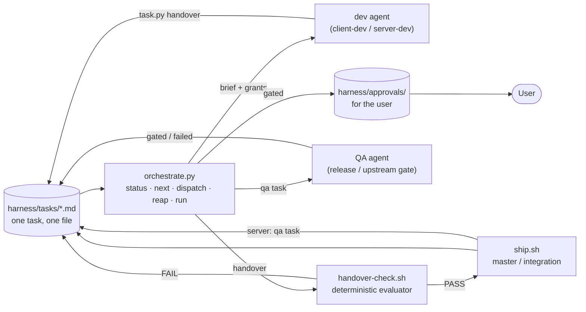

# Harness: the loop as files and scripts

The harness runs two tracks (client: RuneLite plugins in the official OSRS Android app; server: the OpenRune fork
contributed upstream) through one loop, **trigger → analyse → build → verify → ship**, with as few human and
orchestrator turns on the path as possible. docs/workflow.md defines the tracks, roles, gates and skills; this
document is the machinery that drives them and why it is shaped this way. It follows Anthropic's "Harness design
for long-running application development": separate the generator from the evaluator, make the evaluator
skeptical and concrete, keep the planner on deliverables not implementation, move state into files so a session is
disposable, and remove each piece as soon as the model no longer needs it.

## What was slow in the first harness

The first harness (up to 2026-10-19) was a chat session as orchestrator, four role agents, hooks for the gates, and
state spread across docs/backlog.md (tables), two STATE docs ("Next tasks") and docs/orchestrator.md (a queue
rewritten by hand). Measured against the loop, the orchestrator's turn was on the critical path six times per task:

| Step | Who waited on whom | Cost |
|---|---|---|
| Device slot | the dev asked "main" for a grant mid-task | an agent turn lost per slot, and the orchestrator's attention |
| Spec review (server) | the dev stopped until "main" reviewed the spec | the review rarely changed the spec; the stop always cost |
| Hand-over | a chat report of paths; "main" re-read it, merged by hand | reports pulled logs into the orchestrator's context; evidence lived in session scratchpads that vanish |
| Blockers | written in both STATE docs' "Next tasks" by hand | drift between the two; nothing checked that a blocker was cleared |
| Ship (merge, integration, deploy) | a hand procedure each time | errors of omission; no record of which check was done |
| Restart | docs/orchestrator.md rewritten from memory | the queue in that doc was already stale by the time it was read |

The orchestrator session also grew until compaction, then rebuilt its context from a hook that printed both STATE
docs in full (about 400 lines) after each compaction.

## The pieces



| Piece | File | Does |
|---|---|---|
| Task store | `harness/tasks/<id>.md` via `tools/harness/task.py` | One file per deliverable: YAML frontmatter (track, status, prio, role, owner, instances, branch, commit, evidence, blockers) plus `## Task`, `## Definition of done` (checkboxes) and a dated `## Log`. The single source of truth for both tracks; `ready`, `status`, `lint`, `metrics` are computed from it |
| Brief | `task.py brief <id>` | The whole spawn prompt: the id, the agent's name, the granted instances, the evidence dir, how to hand over. Role text stays in `.claude/agents/*.md` |
| Driver | `tools/harness/orchestrate.py` | `status` (dashboard), `next` (what fits the free slots), `dispatch` (name the agent, grant instances with `reuse`, claim, print the brief, or `--run` a headless `claude -p --agent <role>`), `reap` (finished runs → check → ship → QA task → approval), `run` (the loop) |
| Hand-over check | `tools/harness/handover-check.sh <id>` | The evaluator between the dev's claim and the ship step, deterministic; rules below |
| Ship | `tools/harness/ship.sh <id>` | Client: `--no-ff` merge into `master` with the standard message, push to origin main, task `live`. Server: append to `integration.txt`, rebuild `integration` with `build-integration.sh`, push; prints the gate and deploy commands (they reserve instances, so they stay separate). A QA-role task is marked `done` (nothing to merge) |
| Evidence | `re/evidence/<id>/` | Durable, in the main checkout, git-ignored. Screenshots, logcat extracts, the repack log, accuracy results. Replaces per-session scratchpads |
| Instances | `tools/device-lock.sh` + `tools/instances.tsv` | One lock per test instance (`device`, `desktop`; add rows for more BlueStacks instances). `grant <who> <min> reuse` at dispatch: the agent takes and frees it for the whole task without asking |
| Build queue | `tools/buildq.sh`, `openrune/upstream/qa/qa.sh` | Unchanged classes and memory guard; queue and lock dirs moved from a session scratchpad to `re/harness/{buildq,qa}` |
| Stop hooks | `tools/hooks/task_stop.py`, `slot_stop.py` | An agent can't finish while its task is still `in-progress`/`specced`, while it holds a lock, or before the device restore check passed |
| Publish gates | `tools/hooks/publish_gate.py`, `github_scope.py`, `deny_publish.py` (shared parsing: `shellparse.py`) | Upstream PR needs the QA record at the commit; tags need the release record; agents can't push upstream, deploy, grant or write progress (rule below) |
| Approvals | `harness/approvals/<id>.md` | The only thing that reaches the user: an upstream PR, a release, a deploy decision. Written by the driver when a task reaches `gated`, unless the upstream action is already done (below); the orchestrator runs the action in the interactive session (the `ask` rules still prompt), then `task.py done <id>` and removes the file |
| After compaction | `tools/hooks/session_state.sh` | Prints the dashboard (`orchestrate.py status`) and pointers, not the STATE docs |

### Hand-over check rules

- Every task: status `handover`, branch and commit set, definition of done all `[x]`, evidence dir non-empty.
- Client dev: branch at the commit, commit not on `master` yet, a repack log with 7 `telemetry:` lines, a screenshot
  or `*logcat*.txt`, and `netqa*.md` when `network: true`. A docs-only change (every file between
  merge-base(master, commit) and the commit is `*.md`) needs no repack log, device evidence or Network QA.
- QA roles (`*-qa`): a QA task verifies and ships nothing, so the branch and merge items are skipped (`--branch
  master` with a commit already on master is fine); client QA needs the repack log, and `netqa*.md` when
  `network: true`. `ship.sh` then sets an upstream gate (`server-qa`) or a release gate (`release-*`) to `gated`, so
  `reap` files its approval; any other QA task (a capture, a check) becomes `done`. `reap` creates no follow-up task.
- Server dev: commit on `fork/<branch>`, off upstream main, an accuracy spec on the fork's `docs` branch named by any
  of the task's `spec:` key, the branch slug or the task id (`task.py new --server-dod [--spec name]` writes a DoD
  whose spec item names the same file), the fork PR recorded, fork CI `success` at exactly that sha (or `gate:` a
  local gate log with `rc=0`).
- Test overrides: `HARNESS_DIR`, `HANDOVER_REPO`, `HANDOVER_CLONE`, `HANDOVER_GH`, `HANDOVER_EVIDENCE_ROOT`.

### Approvals after a restart

Before `reap` files an approval for a `gated` task it checks whether the user's action was already taken: when the
task's `pr:` (or the last OpenRune PR URL in its log) is an OpenRune/OpenRune-Server PR and `gh api
repos/OpenRune/OpenRune-Server/pulls/<n>` shows it open, not a draft, with its head sha starting with the task's
commit, it logs "upstream action already done (PR #n ready at <sha>)" and files nothing. Any gh error files the
approval as before. PR bodies are edited with `gh api -X PATCH repos/<repo>/pulls/<n>` (`gh pr edit` fails on
OpenRune-Server: deprecated projectCards field); `tools/fork.sh pr-edit` does that for the fork.

### The role hook (deny_publish.py)

Agents can't push, write to GitHub, run `fork.sh`, deploy, grant devices or write progress, except:
- `--fork-writes` (server-dev): a push whose remote URL resolves to `AlexPerrin/OpenRune-Server`, `tools/fork.sh`,
  and gh writes whose every gh segment names `AlexPerrin/OpenRune-Server`. The target is resolved, not guessed: the
  remote after `push` (options and redirections like `2>&1` skipped), the directory from `git -C` and/or the last
  `cd`, else the hook's `cwd`, then `git remote get-url --push`. In `re/upstream-pr/or`, `origin` is OpenRune and
  `fork` is ours; in `re/agents/<name>/or` and docs clones, `origin` is the fork. Denied: a bare `git push` (target
  unknown), a push onto the fork's `main`, `--mirror`, anything naming OpenRune/OpenRune or github.com/OpenRune/,
  and pushes the parser can't see (`bash -c`, `$(...)`, heredocs).
- `--docs-writes` (server-qa): one non-forced refspec onto `docs`, remote resolving to the fork.
- Integration images and deploys (docs/integration-pipeline.md) are denied to every agent role, whatever the flags:
  `tools/harness/deploy.sh` and `image.sh` (also `./deploy.sh` from `tools/harness`), `orchestrate.py
  deploy|integrate|image`, `docker [image|container] tag|rm|rmi|stop|restart|kill` naming an `osrs-openrune` image or
  container, and `docker compose`/`docker-compose` writes that name `osrs-openrune`, the live stack's service
  `openrune` or `openrune/docker-compose.yml`, or run from `openrune/` (ps, logs, config, ls, images, top and version
  stay allowed). The agents' own containers (`qa-or-*`, branch images) are not affected.
- The word "upstream" alone (file names, commit messages, `re/upstream-pr/`) means nothing to the hook.

### Tests

`tools/harness/tests/run.sh` (or `python3 -m unittest discover -s tools/harness/tests`): the hook table (temp repos
whose remotes point at the fork or OpenRune), the hand-over check per track and role (temp repos, a local bare
"fork", a gh stub), the QA ship path, reap approvals with gh stubbed, `task.py lint` on the live store
(read-only), and test_live.py (the `live` status and unblocking, `migrate-live`, the client ship to `live` in a temp
checkout, the integration deny rules, `LOCK_DIR` in device-lock.sh, which sets where the lock, grant and status
files live; default `/tmp`). No network or devices. Run them after any change to `tools/hooks/` or `tools/harness/`.

### Task lifecycle

```
backlog → ready → in-progress → (specced, server) → handover → shipped → live → qa → gated → done
                     ↓ blocked_by …          ↑ FAIL (check)   (server)   ↑         ↓ FAIL (gate)   ↓ waiting-user
                   blocked ──────────────────┘         client ship ──────┘       failed → fix task
```

- `backlog`: a deliverable without a definition of done yet (the roadmap). `ready`: dispatchable once every
  `blocked_by` task is `done`, `live`, `qa` or `gated`. **Not `shipped`**: a server task is `shipped` once it is in
  `integration`, but the live server only has it after the gate, image and deploy; a client task blocked on it
  would be dispatched against a server that doesn't have the fix yet (the bug fixed in phase 0 of
  docs/integration-pipeline.md).
- `live`: the change is on its live target. Server: deployed on the live server (the orchestrator sets it after the
  deploy; later `deploy.sh` does). Local-only server tasks then go `live` → `done`. Client: **`ship.sh` sets `live`
  directly**, because the client's live target is `master` itself: agents build and test from `master`, there is no
  deploy step after the merge, and a release (vX.Y.Z) is a separate gate with its own task, not a precondition for
  other tasks.
- A **blocker** between tracks is an edge, not prose: the client dev runs `task.py new --track server ...` for the
  server task and `task.py block <mine> --by <it>`. When the server task becomes `live` or `done` (through `task.py
  done`, `task.py set <id> status=live|done` or `migrate-live`), every task it unblocks that is `blocked` and has no
  open blocker left goes back to `ready`. `lint` rejects dangling edges and cycles.
- `task.py migrate-live [id ...] [--dry-run]` (one-off, 2026-10-20) moves `shipped` tasks that are already live to
  `live`: a server task whose log has the orchestrator's `Live <date> ...` deploy line, and a client task (merged into
  master). A server task without that line (shipped, not deployed) stays `shipped`.
- A **hand-over** is `task.py handover` with branch, commit, evidence and summary after every definition-of-done
  box is `[x]`. The check and the ship step need no chat. A check FAIL sets the task back to `ready` with the failing
  items in the log; the next dispatch (a fresh agent, same role) fixes exactly those.
- **QA** runs only at the two outward gates (docs/workflow.md "Gates"). A server ship creates `qa-<id>` for
  `server-qa` automatically; a client release task is created by the orchestrator when a release is due. A gate PASS
  sets `gated` and files an approval; a FAIL sets `failed` with the record path in the log, and the orchestrator
  creates the fix task for the dev (same slug, `-fix`).

### Who does what now

| | Before | Now |
|---|---|---|
| Orchestrator (interactive) | granted slots, reviewed specs, read reports, merged, rebuilt integration, deployed, rewrote the queue | dispatches (`orchestrate.py dispatch` or `run`), decides what `next` says to decide, runs approvals and deploys, writes decisions in docs/orchestrator.md |
| Dev agent | asked for slots, reported in chat, evidence in its scratchpad | takes its granted instances, hands over on disk, evidence in `re/evidence/<id>/`; the server spec is committed and work continues (`specced`) unless a decision is needed |
| QA agent | reported a verdict in chat | records the verdict, sets `gated`/`failed` |
| User | approved upstream PRs, releases, restarts | the same, from `harness/approvals/` and the ask prompts |

## Running it

**Interactive (default).** The orchestrator session:
```
tools/harness/orchestrate.py status                 # where everything is
tools/harness/orchestrate.py next                   # what fits the free slots
tools/harness/orchestrate.py dispatch <id>          # grants, claims, prints the brief
  → Agent(subagent_type=<role>, isolation=worktree for client roles, prompt=<the brief>)
tools/harness/orchestrate.py reap                   # after agents finish: check, ship, QA task, approvals
tools/harness/orchestrate.py approvals              # what the user must decide
```
`reap` also picks up hand-overs from in-session agents (no run record): any task in `handover` without a check gets
one. Server ships print the integration gate and deploy commands; the orchestrator runs them when both instances
are free (standing approval for deploys with a rollback tag).

**Headless (autonomous loop).**
```
tools/harness/orchestrate.py run --interval 120     # reap, dispatch while slots are free, repeat; Ctrl-C to stop
tools/harness/orchestrate.py run --once             # one pass
```
`dispatch --run` starts `claude -p --agent <role> --permission-mode $HARNESS_PERMISSION_MODE --output-format stream-json --verbose` (every tool call is a line in `re/harness/runs/<name>.log`) (default `auto`)
with the brief, in a worktree under `re/harness/wt/<name>` for client roles, logs under `re/harness/runs/`. In
`-p` mode nobody answers permission prompts: anything outside the allow rules is denied, so before the first
headless run extend `.claude/settings.local.json` for the agents' routine commands (the `fewer-permission-prompts`
skill reads the transcripts and proposes the list). The role hooks still deny pushes upstream, deploys and grants,
and the stop hooks still hold an agent until its task is on disk and its instance is restored. The loop never
touches upstream or releases: those are approval files for the interactive session.

Slots: `HARNESS_MAX_CLIENT` (1, one Android instance), `HARNESS_MAX_SERVER` (2), one QA companion per track. A
second BlueStacks instance is a row in `tools/instances.tsv`, its MCP server in `.mcp.json`, and
`HARNESS_MAX_CLIENT=2`.

## Design notes (what the article says, and what it means here)

- **Generator and evaluator are separate, and the evaluator is skeptical and concrete.** Self-evaluation is lenient;
  here the dev's check is kept (the user's velocity decision: no QA before `master`/`integration`) but its *claims*
  are verified mechanically by `handover-check.sh`, which only passes on evidence that exists (the repack log's
  telemetry lines, a screenshot, CI `success` at the sha, the spec file). The two outward gates keep an independent
  LLM evaluator (QA companion) with a record the publish hooks parse.
- **Encode quality as gradable criteria weighted toward what the model does poorly by default.** Here: OSRS accuracy
  with cited sources (the accuracy spec and its RSProx comparison), one change per PR, privacy (Network QA, telemetry
  assertions), device-verified behaviour. These are definition-of-done items and gate checklists, not prose.
- **Sprint contracts.** Every task has a definition of done before dispatch (`lint` and `dispatch` refuse one
  without). The server spec is the contract for content work; it is committed and the dev continues (`specced`)
  rather than waiting, because the review almost never changed the spec but always cost a turn.
- **Context.** The orchestrator's context is for decisions. Agents report one line; results live in task files;
  after compaction the hook prints a dashboard, not documents. Agents hand read-heavy lookups to read-only subtasks
  (role files, "Subtasks").
- **Disposable sessions.** Everything a restart needs is on disk: the task store, run records, approvals,
  `docs/orchestrator.md` for decisions only. A fresh orchestrator runs `orchestrate.py status` and continues.
- **Remove what isn't load-bearing.** `task.py metrics` gives cycle times and rework counts per task from the logs.
  If a check never fails over a month, drop it; if a human step never changes the outcome (the spec review did
  not), make it asynchronous, as done here.

## First headless run (cd47, host-menu-entry-removal, 2026-10-19)

94 turns, 15 minutes, $7.38, one classifier denial, handed over with evidence; the hand-over check and the ship step
ran from `reap`. What it taught, now fixed:
- A client worktree lacks every git-ignored input: `re/` (build outputs, Ghidra, RuneLite sources), the official
  APKs, `openrune/src` (the repack's modulus). `dispatch --run` now symlinks them from the main checkout. The Read
  tool refuses paths that resolve through those symlinks; agents read evidence with shell commands.
- `--permission-mode bypassPermissions` is refused by the classifier when launched from a session; `auto` works and
  keeps the role hooks (a grant was denied, read-only commands ran).
- Without the `osrs-devtools` MCP set up at the start of the slot, the agent fell back to raw `adb` input and
  screenshots, which `exec-out` returned empty through WSL interop several times. Rule since then (CLAUDE.md, the
  brief, device-test): game state through the data tools; screenshots only for drawing claims.
- The restore check caught real drift (a leftover file, settings.properties rewritten by the login) and the stop
  hook held the agent until it was fixed; that is the gate working as designed.

## Not built yet
- `build-integration.sh` refusing a branch without green CI at its commit (today `handover-check.sh` is the only
  guard before `ship.sh`).
- A headless server task: only a client task has run headless so far (above). Watch the first server-dev and
  server-qa runs before trusting `run` unattended.
- The release path: `release-vX.Y.Z` client-qa tasks are created by hand; the tag and GitHub release stay in the
  interactive session (publish_gate.py).
