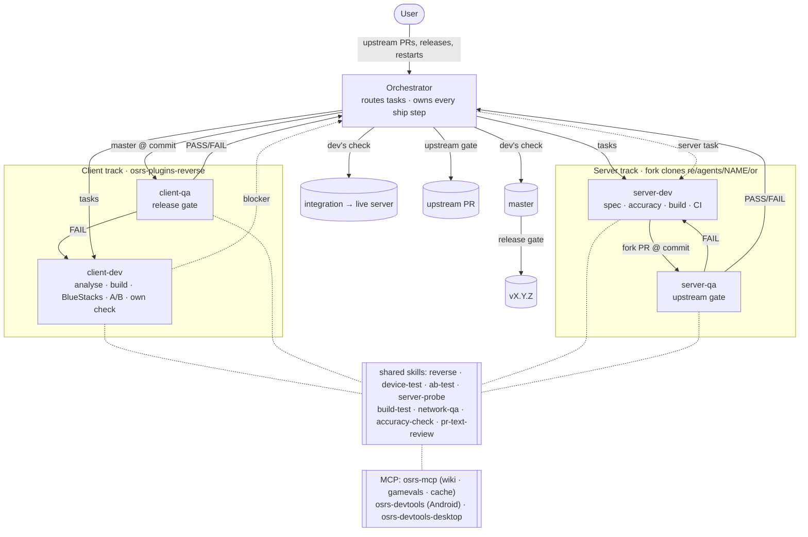

# Workflow: one loop, two tracks

Both tracks run the same loop: **trigger → analyse → build → verify → ship**. Each track has one dev agent and
one QA companion. The orchestrator (the main session) sits above both: it routes tasks, does every ship step
(push, PR, deploy, release, tag) and decides. Agents never push, post or deploy.

| Slot | Client track | Server track |
|---|---|---|
| Goal | RuneLite plugins running in the official OSRS Android app | The test server those plugins run against, contributed upstream |
| Repo | `AlexPerrin/osrs-plugins-reverse` (this repo) | `AlexPerrin/OpenRune-Server`, a fork of upstream `OpenRune/OpenRune-Server` |
| Code | `native/`, `host/`, APK repack (`tools/repack.sh`, `patch_telemetry.py`, `patch_server.py`), `sidecar/` (today `server/`) | OpenRune content, engine fixes, our local-only pieces |
| Trigger | The plugin backlog | A client blocker, or the feature backlog |
| Analyse | The client (Ghidra), the server when needed, ids and data (`osrs-mcp`) | The accuracy baseline (`osrs-mcp`: wiki, cache, gamevals; Mod posts); the client's side of the protocol (Ghidra) |
| Verify | BlueStacks against the test server; A/B against desktop RuneLite | Unit and integration tests, boot; desktop RuneLite against the branch's own server |
| Gates | Dev's own check (no QA) for `master`, release gate | Dev's own check (no QA) for the fork, upstream gate |
| Ships to | `master`, then a tagged release (semver `vX.Y.Z`, pre-releases `vX.Y.Z-dev`) | `integration` and the live test server, then an upstream PR |
| Agents | `client-dev` + `client-qa` | `server-dev` + `server-qa` |
| State | `docs/client-state.md`, records in `qa/` | `STATE.md`, `accuracy/`, `qa/` on the fork's `docs` branch |

Shared workspace tooling stays in this repo: `tools/buildq.sh` (build queue), `tools/device-lock.sh`,
`tools/device-restore-check.sh`, `tools/fork.sh`, `tools/multiclient/`, `tools/progress.py`, and the test
environment (the compose stack that runs the live server and sidecars, pinned to a fork commit). Every agent is
spawned from the orchestrator's session here.

## Client track

1. **Trigger.** A plugin or feature from the backlog, as one task with its definition of done.
2. **Analyse.** The client with the `reverse` skill (Ghidra), and the server with `server-probe` when the
   feature depends on what the server sends.
3. **Build** on a short branch `client/<topic>` in this repo. Small fixes may go straight to `master`.
4. **Verify** by trying the changed plugin or host path on the device (`device-test`, BlueStacks against the
   test server), as the dev does anyway while developing. When the server is missing something, the dev raises
   a **blocker** (below) instead of working around it.
5. **Dev's check.** The hand-over is the branch at a commit, built, with the device evidence of the changed path
   (a screenshot or log). The orchestrator merges it to `master`; no QA run. Dev builds (`tools/release-dev.sh`,
   `vX.Y.Z-dev.N`) stay automated.
   - **Automatic checks live in tooling**, not in the dev's steps: `repack.sh`'s telemetry assertions (the build
     fails without its 7 `telemetry:` lines), the hub netcheck at build and R1 NetScan at load (no raw-socket
     plugins), the release hook. The dev doesn't re-verify them by hand.
   - **Only when relevant, never a fixed step:** `network-qa` when a change adds or alters outbound traffic (a new
     host, a new fetch); `ab-test` when it claims parity with desktop drawing. `reverse` cross-checks are the
     dev's tool, not a gate. The restore check runs once at the end of a device slot (it's about sharing the
     device, not about the change).
6. **Release gate.** When a set of features is ready, `client-qa` runs the release QA on `master`; on PASS the
   orchestrator tags `vX.Y.Z` (https://semver.org; a pre-release such as `v0.1.0-dev` is a GitHub pre-release). The record is `qa/client-X.Y.Z[-pre].md`. A GitHub release is published only with the user's confirmation. The full
   repacked APK is attached (user's decision, 2026-10-19, knowing it contains Jagex's app); the gate checks it
   carries no secrets or personal data.

Client QA (the release gate) covers: a device regression (core plugins and pinned hub plugins, scripted through
the devtools bridge where possible, with the plugin-host table updated); Network QA (docs/app-telemetry.md) for
every release (the dev runs it for a change that adds or alters outbound traffic); desktop A/B for plugins that
draw things; sign-in (LOCAL_AUTH) and the privacy patches present in the build (the `repack.sh` +
`patch_telemetry.py` log); native claims checked with `reverse`. This is where cross-change regressions are caught.

## Server track

### Branches on the fork
- `main`: mirrors upstream `main` exactly. Only `tools/fork.sh sync` (fast-forward) moves it.
- `content/<slug>` and `fix/<slug>`: one self-contained feature or fix each, off `main`. These are what get PR'd
  upstream (see "Changes for upstream"). Existing `fix/NN-<slug>` branches keep their names until merged.
- `local/*`: our test-only pieces that never go upstream (Android protocol support, LOCAL_AUTH, test commands,
  world settings, deploy files). Small and separate by topic.
- `integration` (the fork's default branch): `main` + every `content/*` and `fix/*` handed over with the dev's
  check and not merged upstream yet + every `local/*`, merged in a recorded order (`integration.txt`). Rebuilt by
  `scripts/build-integration.sh`, never hand-edited. The live server builds from a pinned `integration` commit.
- `docs`: STATE.md, accuracy specs, QA records, PR texts, UPSTREAM-PRS.md.

### Changes for upstream
Our server work started as numbered patches over a pinned commit (`openrune/upstream/NN-*.patch`, applied in
number order). That made changes stack and grow; once they became PRs, maintainers asked for smaller scope (on
#366: pull Romeo & Juliet out, upstream already had #299). From now on:
- **One change per PR**: one quest, one feature, one fix. A fix found along the way (e.g. a ladder) is its own
  `fix/<slug>`. A large feature is split along its own seams before coding (a shared base first, then each part),
  and the split is in the spec.
- **No numbers.** A change is named by its slug, used for the branch, `accuracy/<slug>.md`, `qa/<slug>.md` and the
  PR text. Order and dependencies are written down (`Depends:` in the spec and the PR text), not encoded in a
  number. The `NN-*.patch` files and `id-allocation.json` are history; no new ones.
- **Off current `main`, independent, never stacked** (user, 2026-10-18). Each upstream PR is based on upstream
  `main`, builds and tests on its own, and contains no commit of another open PR. Shared code goes in its own small
  change; a change that needs it stays in the fork queue and goes upstream only after the shared change has merged
  and the branch is rebased on the new `main`.
- **Upstream's AGENTS.md conventions** (on upstream `main`; maintainers apply them in review): tests only for real
  logic that moves items or state, not for a simple op handler or a wiki string ("No Test is needed" on #348); no
  new KDoc or explanatory comments ("Comments — less is more"); nothing made public just for a test. Server toggles
  go in the server config with a default.
- **Upstream's PR template** (`.github/pull_request_template.md`, #369): every PR text uses its sections (Summary,
  Type of change, How it was tested, Checklist, notes). Its checklist asks for in-game verification end to end without
  cheats where possible, state in varbits/varps not attrs, gamevals symbols not raw ids, wiki deviations noted in
  upstream's `docs/quirks.md` (their file, part of the change), and rsprox-dump checks "where possible" (done by the accuracy check's RSProx comparison; tick it only when that
  found a recording and was done).
- **Check upstream first.** Before the spec: open PRs, issues and recent `main` commits for the same content
  (`gh pr list -R OpenRune/OpenRune-Server --search <topic>`). If upstream has it, build on theirs or drop ours.

### Gameval ids
Follow upstream's procedure (`tools/scripts/fix_gameval_conflicts.py`, and its CI check on every PR):
- Write each new gameval as `name = -1` and run `python3 tools/scripts/fix_gameval_conflicts.py` on the branch
  (needs `.data/gamevals-binary/max-ids.toml` from `freshCache`); it assigns free ids above the OSRS max.
  Commit the result.
- Names are what matter: saves are keyed by name, and code uses names, not numbers. Prefix names with the
  feature (`sheep_shearer_*`). Renaming a gameval or moving a varbit's bits needs a data migration; renumbering
  doesn't.
- After `scripts/build-integration.sh`, run `fix_gameval_conflicts.py --check` on the integration tree. If two of
  our branches clash, apply the id it reports to the branch that came later in `integration.txt`.
- Upstream's CI can't push to a fork PR; when it comments a reassignment, apply it on the branch.

### Flow for a feature or fix
1. **Trigger.** A client blocker, or a feature from the backlog.
2. **Spec first.** `accuracy/<slug>.md` on `docs`: what upstream already has, each mechanic with its source
   (wiki section, cache, Mod post), the planned behaviour, caveats, guesses, the tests, and the PR split. The
   orchestrator reviews it before coding.
3. **Build** on `content/<slug>` or `fix/<slug>` off `main`, in the server dev's own clone, with tests for each
   rule and ids assigned as above.
4. **Fork PR.** The orchestrator pushes the branch and opens the PR on the fork (`tools/fork.sh`, no
   confirmation), so CI and QA have a fixed commit.
5. **Dev's check** (`server-dev`, no QA step; user, 2026-10-19: "keep the gates minimal for developers"): the dev
   owns accuracy during feature work: the spec with `accuracy-check` (wiki/cache baseline, including its RSProx
   comparison), behaviour checked against it (in-game on desktop RuneLite where a plugin renders something), and
   green build evidence at the commit (the fork's GitHub Actions CI; `qa.sh dev`/`qa.sh gate` where CI doesn't
   apply). On hand-over with that evidence the orchestrator adds the branch to `integration` and deploys. A client
   blocker is unblocked here.
6. **Upstream gate** (`server-qa`, the track's only QA step): is it ready for upstream? An independent re-check of
   accuracy (`accuracy-check`, including the RSProx comparison) and in-game behaviour, CI green at the exact
   commit, plus one change only (nothing unrelated, no overlap with an upstream PR, none of our own docs: STATE.md, specs, QA
   records and PR texts live only on the fork's `docs` branch and never go upstream), based on current `main`,
   `fix_gameval_conflicts.py --check` clean, upstream's CONTRIBUTING (commit style, PR text with problem,
   change, tests, data sources, caveats, release note and checklist), every claim in the PR text true of the
   commit, and caveats covering every gap the accuracy check found. On PASS the fork PR joins the **upstream queue**
   (docs/backlog.md "Upstream queue"). Nothing goes upstream (PR, push to a PR's branch, edit, comment, ready) until
   the user approves that item in discussion.
7. **Upstream merge.** `fork.sh sync`, drop the branch from `integration.txt`, rebuild `integration`, deploy.

A new commit voids the upstream gate and needs the dev's evidence again. The branch stays in `integration` at
the last commit handed over with that evidence until the new one is. Pushes to a branch that already has an open upstream PR change that PR, so they ask
the user.

### Live server
- Built from a pinned `integration` commit. The orchestrator deploys boot-checked images when both devices are
  free, with a rollback tag (standing approval).
- Live ids are the ids on the branches (see "Gameval ids").

## Blockers between tracks

A blocker is a task, not a message chain. When the client needs something from the server:
1. The client dev reports it to the orchestrator: a repro on the test server, the expected behaviour and its
   source, and evidence (a Ghidra finding, an A/B run, a `server-probe` capture).
2. The orchestrator files it as a server task that blocks the client task, and pauses or re-scopes the client
   task.
3. The server task ships on the dev's checked hand-over (spec, accuracy check, green CI) to the live server.
   The orchestrator then unblocks the client task. The upstream gate follows on its own schedule; the client never waits for it.

The same applies the other way (a server task that needs a client change or a device check).

## Agents

- **Task-scoped agents, not open-ended generations.** Each spawn gets one deliverable and its definition of
  done, finishes, rewrites its STATE lines and reports. Long work is split into tasks.
- **Roster:** the orchestrator; per track one dev (two server devs at most, each owning its own branches) and
  one QA companion per dev.
- **Role files** in `.claude/agents/` (`client-dev`, `client-qa`, `server-dev`, `server-qa`) hold each role's
  standing brief: its track's slots, its gate, its limits. Hooks and `maxTurns` in the frontmatter enforce the
  limits. A spawn's brief is only the task, its definition of done, and (server) the agent's name and branches.
  Spawn by `subagent_type`, never `general-purpose`. Inside a task, devs and QA hand read-heavy lookups
  (RSProx transcripts, logs, wiki and cache sweeps) to their own read-only subtasks and keep only the
  conclusion (each role file's "Subtasks" section).
- **Where they work.** The client roles work in this repo, always in their own worktree (`isolation: worktree`): the orchestrator commits on `master` in the main tree, and an agent that checks out its branch there sends those commits to its branch.
  The server roles each work in their own fork clone, `re/agents/<name>/or`, with `docs` checked out beside it
  as a worktree; a shared working tree leaks build outputs between branches. During the move, server QA records
  and QA.md may still be in `openrune/upstream/` here; the hooks read both places.
- **QA is a companion.** It gates only what goes out to others: the orchestrator hands it `master` at a commit
  for a client release, or a server dev's fork branch at a commit for upstream, and the dev moves on to its next
  task; the companion runs the gate, records the result, sends fixes back to its dev, and reports PASS or FAIL
  to the orchestrator.
  A companion never writes the code it checks (a hook limits it to records, QA.md and scratch files).
- **One owner per branch or area at a time.** Another agent that needs a change sends it to the owner, through
  the orchestrator.

## Shared skills

Tools belong to no role. Each is a skill any agent calls when it needs it: a dev while building, a companion
against a fixed commit for its gate. Only the companion's run counts for a QA gate; a dev's run is evidence it
hands over (the dev's check that puts a branch into `master` or `integration`).

| Skill | What it does | Resource | Typical callers |
|---|---|---|---|
| `reverse` | Headless Ghidra on `re/ghidra` (`tools/ghidra_scripts/`: Decompile, Callers, Xrefs, StringXrefs, FindScalar), jadx, the in-app agent (`tools/agent.py`): offsets, struct layouts, xrefs, the client's side of the protocol, patched bytes and their callers | one Ghidra writer at a time (`-readOnly` otherwise) | client-dev, server-dev, client-qa (native claims), server-qa (protocol claims) |
| `device-test` | BlueStacks against the test server, in a device slot, driven through `osrs-devtools`: restore-check `pre`, the test, `check` until all OK, free | device lock | client-dev, client-qa |
| `ab-test` | The same plugin or feature on desktop RuneLite (`osrs-devtools-desktop`) and Android (`osrs-devtools`), or on the branch server and `main` | desktop lock (+ device lock) | all four |
| `server-probe` | What the server does: logs, protocol captures, `tools/openrune-sql.sh` reads; ids and decoded cache data through `osrs-mcp` | none | client-dev, server-dev |
| `build-test` | The gate: clean build in one container from the shared build cache (tests always run); `spotlessCheck`, `test`, `integration`; boot to "Server ready in" (server); warm dev builds of changed modules; host builds (client) | `buildq` slot | all four |
| `network-qa` | The Network QA procedure: DNS, sockets, expected hosts, the telemetry patch log | device lock | client-dev, client-qa |
| `accuracy-check` | The spec before code; behaviour against the spec and its sources after (`osrs-mcp`: wiki pages, NPC spawns, cache); the caveats the PR must declare | none | server-dev (writes the spec), server-qa |
| `pr-text-review` | Every claim in a PR or release text is true of the commit; CONTRIBUTING's sections present | none | server-dev, server-qa, client-qa |

Each is `.claude/skills/<name>/SKILL.md`: inputs, steps, evidence, and the PASS criteria a companion records.
Heavy ones (`reverse`, `build-test`) use `context: fork`. A skill bundles the scripts it runs, and only its name
and description are in context until it's used. The skills point to the procedures in docs/app-telemetry.md,
docs/multi-client.md, QA.md and STATE.md rather than restating them; change the procedure there.

### MCP servers

The skills reach the game through three MCP servers. Agents inherit the session's MCP tools; load them with
ToolSearch (e.g. `select:mcp__osrs-mcp__wiki_page,mcp__osrs-mcp__gameval_search`).

| Server | What it gives | Where it runs | Rules | Used by |
|---|---|---|---|---|
| `osrs-mcp` (OpenRune's own) | `wiki_search`, `wiki_page`, `wiki_npc_spawns` (OSRS Wiki); `gameval_search` (names ↔ ids); `cache_search` (decoded cache); `*_reload` | `tools/osrs-mcp/run.sh`: Docker, jars, gamevals, cache and game.yml mounted read-only, no server keys, no live-server control | No lock. Gamevals and cache are the tree it was built from (`openrune/src`), not upstream `main`; ids are assigned by upstream's tool ("Gameval ids"), not looked up here. Rebuild: `openrune/scripts/openrune.sh gradle :tools:osrs-mcp:installDist --no-configuration-cache` | all four: the accuracy baseline (specs and checks), ids for plugins and content |
| `osrs-devtools` | OpenRune-Developer-Tools in the Android plugin host: client state, chat, NPC/object/item actions, vars, dialogue, walking, screenshots | `tools/devtools-mcp.sh`: adb bridge to the device, per-process token from logcat | Only while holding the device lock. Needs `devtools.jar` in plugins/, `setprop debug.osrsrl.devtools 1` and a restart; remove both at the end of the slot. `get_chat_history` under-reports repeats: confirm by screenshot | client-dev, client-qa |
| `osrs-devtools-desktop` | The same tools in the isolated desktop RuneLite | `tools/multiclient/desktop-devtools-mcp.sh`: Windows curl.exe to the client's loopback port; start the client first (`tools/multiclient/desktop.sh start`) | Only while holding the desktop lock; profile under C:\osrs-test only | all four (`ab-test`, server in-game checks) |

## Gates

Every gate is defined before its work starts, and recorded against an exact commit. A new commit voids it.

| Gate | Track | Run by | Checks | On PASS |
|---|---|---|---|---|
| Dev's check | client | `client-dev` (no QA) | Built, and the changed plugin or host path tried on the device (screenshot or log); `network-qa` only for new or changed outbound traffic, `ab-test` only for a desktop-parity claim. Telemetry assertions, netcheck/NetScan and the release hook are automatic | merge to `master` |
| Release | client | `client-qa` | Full client QA on `master`, Network QA, privacy patches in the build | tag; GitHub release on the user's OK |
| Dev's check | server | `server-dev` (no QA) | Spec with `accuracy-check` (including its RSProx comparison), behaviour against it, in-game where it renders, `build-test` evidence (the fork's GitHub Actions CI at the commit; `qa.sh dev`/`qa.sh gate` where CI doesn't apply; local `qa.sh gate` for `integration`) | into `integration`, deploy |
| Upstream | server | `server-qa` | Independent `accuracy-check` (including RSProx) and in-game re-check, CI at the exact commit, one change only, no upstream overlap, on current `main`, `fix_gameval_conflicts.py --check`, CONTRIBUTING, AGENTS.md, PR template, `pr-text-review`, caveats complete | upstream queue (fork PR); upstream only on the user's approval per item |

Records start with these lines exactly, because the hooks parse them:
```
# QA: <branch or version>
- Branch: `<branch>`
- Commit: `<full sha>`
## Upstream gate: **PASS**     (server; or **FAIL**, or **PENDING** until it runs)
## Verdict: **PASS**           (client release; or **FAIL**)
```
A FAIL says precisely what must change. A server record may also carry `## Internal gate: N/A (dev-checked)`, or
omit that line; older records with an internal gate line keep it, and the hook reads only the upstream line. Older
server records with only `## Verdict:` were full QA runs and count as the upstream gate. Client merges have no
record (older `qa/client-<topic>.md` merge records stay as history); only `qa/client-X.Y.Z[-pre].md` gates a tag.

Each user rule gets an observable check where possible, not only an instruction: Network QA for "never contact
Jagex", netcheck/R1 for plugin networking, the telemetry patch's one-match assertions, buildq for build
concurrency, and the hooks below.

## State

- **Each track keeps a short STATE doc** (`docs/client-state.md`; `STATE.md` on the fork's `docs` branch), under
  about 150 lines: what's live, the gotchas, the next tasks. Rewritten, not appended to. A new agent reads it
  first. History goes to the handoff docs, read only when needed.
- **Gotchas that keep recurring become checks or tools, not prose** (the device restore check, test jars removed
  by name only).
- **Blockers are written in both STATE docs' "Next tasks"**: the client task says `blocked by server: <slug>`, the
  server task says `unblocks client: <task>`. The orchestrator clears both when the server change is handed over
  with the dev's check and is live.
- **The orchestrator keeps its context small** by delegating anything beyond a couple of quick commands to a subagent
  and relaying verdicts, not logs. It keeps docs/orchestrator.md (in-flight agents, pending decisions, locks) current
  at milestones. It restarts only to avoid repeated compaction (not on a schedule): then a fresh session takes over
  from that doc, the STATE docs, the QA records and docs/backlog.md. After each
  compaction a `SessionStart` hook (`tools/hooks/session_state.sh`) prints both STATE docs, the lock and build
  queue status, and the recent log.

## Harness



| Piece | Where | What it enforces |
|---|---|---|
| Role files | `.claude/agents/{client,server}-{dev,qa}.md` | Standing brief, hooks, `maxTurns` 400 (dev) / 300 (QA) |
| Shared rules | `CLAUDE.md` | Loaded by every agent, and again after each compaction |
| Upstream publish gate | `tools/hooks/publish_gate.py` (settings) | An upstream `gh pr create` needs `## Upstream gate: **PASS**` at the fork branch's commit |
| Client release gate | `tools/hooks/publish_gate.py` (settings) | `git tag vX.Y.Z[-pre]` and `gh release create vX.Y.Z[-pre]` need `qa/client-X.Y.Z[-pre].md` with `## Verdict: **PASS**` for the tagged commit |
| State after compaction | `tools/hooks/session_state.sh` (settings, `SessionStart` `compact`) | The orchestrator rebuilds from disk, not from the summary |
| Shared skills | `.claude/skills/<name>/SKILL.md` | One procedure per tool, for dev and QA alike |
| Orchestrator-only actions | `tools/hooks/deny_publish.py` (role files) | Agents can't push, post, run fork.sh, deploy, grant devices or write progress |
| QA write scope | `tools/hooks/qa_write_scope.py` (QA role files) | Companions write records, QA.md and scratch files only |
| Slot stop gate | `tools/hooks/slot_stop.py <holder>` (settings) | No agent finishes holding a lock, or with a device slot that hasn't passed its restore check |
| Permissions | `.claude/settings.json` | Every GitHub write and push asks the user |

How it handles the bottlenecks:
- **Waiting for a merge.** Both tracks ship to their own trunk (`master`, `integration`) on the dev's checked
  hand-over; QA runs only on what goes out to others (a client release, an upstream PR).
- **The client waiting on the server.** Blockers ship on the dev's checked hand-over to the live server; the
  upstream gate happens afterwards and never holds the client.
- **Waiting for review.** The companion takes over shipping to others (a release, an upstream PR), so a dev
  starts its next task on hand-over: feature N is in QA while N+1 is being built.
- **Rework.** The spec and the gate are fixed before coding. A FAIL goes back to the same dev with exactly what
  must change.
- **Devices and builds.** Expiring grants and the buildq FIFO; devices always come back restored; one clone per
  server agent.
- **The user's attention.** Asked only for upstream PRs, releases and restarts, and nothing reaches the prompt
  before its gate passes.
- **Context.** Role text lives in files, reports are PASS/FAIL plus evidence paths, state is on disk, and each
  spawn is one task with a turn cap. The orchestrator relays decisions, not reports, and batches pushes and
  grants. Builds are waited on with a background command that notifies, not by polling.

Not built yet: an integration check (`scripts/build-integration.sh` refusing a `content/*` or `fix/*` branch
without green CI at its commit).

Why: up to gen 40, a single orchestrator session ran for about 2.7 days through 4 compactions, spawning 79
general-purpose agents with briefs of about 3,700 characters, and each dev generation ran 2,500-3,900 turns before
it was replaced. Sources: the Claude Code docs on hooks, subagents, skills, and memory and context; Anthropic's
"Effective harnesses for long-running agents" and "Building verification loops in Claude Code with skills".

## Capacity

The machine has 16 threads. WSL has 20 GB (`.wslconfig`); Windows (the host) the rest.
- **GitHub Actions** on the fork runs upstream's CI (build, tests, boot) for upstream-bound branches on GitHub's runners,
  in parallel and free (public repo), so those gates use no local build slot. Local slots are for `integration`, the
  live image, branch servers for in-game checks, and dev builds.
- **Windows:** several BlueStacks instances (about 2-3 GB each) and desktop RuneLite clients (about 1 GB each).
  Each dev/QA pair gets its own BlueStacks instance and desktop client (own profile and port), so pairs never
  wait for each other; the device lock becomes one lock per instance (`LOCK_NAME=<instance>`). Only a server
  restart reserves all of them. The device is the client's real bottleneck: a second BlueStacks instance with
  its own lock (`LOCK_NAME`) lets the release gate or a second dev run without blocking the first.
- **WSL (20 GB):** the live server, the sidecars and the Gradle build cache node (about 3.5 GB together), QA
  branch servers on spare ports, and the build queue (`tools/buildq.sh`) in classes with their own slots, so
  one class never starves another (FIFO within a class, `BUILDQ_PRIO=1` first):
  - **gate** (2 slots, 5 GB containers): QA gates (`qa.sh gate`, priority) and any other full build.
  - **dev** (2 slots): the dev lane. Each server dev has one warm container `qa-dev-<owner>` (4 GB limit,
    about 2.2 GB idle, a persistent Gradle daemon, its own Gradle home), made on first use and stopped by
    `qa.sh dev-stop <owner>` or after 45 idle minutes; builds exec into it (seconds for an incremental
    compile), so dev evidence never waits behind gates.
  - **measure** (1 slot): timing runs.
  A ticket starts only while MemAvailable, less a ramp reserve for containers started in the last 2 minutes,
  covers its need (gate 5.5 GB, a new dev container 4.5 GB, a warm one 1 GB), so the queue never pushes WSL
  into OOM.
- **Builds:** each container has its own Gradle home volume (a shared one deadlocks on Gradle's journal
  lock) and shares compiled outputs through the remote build cache node (`tools/gradle-cache.sh`: HTTP, safe
  for concurrent builds, 20 GiB LRU). Tests are never cached. The OpenRS2 cache download is shared by cache
  id (`openrune-dl-cache`).

## Shared rules
- **Builds** go through `tools/buildq.sh` (classes gate/dev/measure with a memory guard; gates in one 5 GB
  container via `qa.sh gate`, dev builds in the dev's warm container via `qa.sh dev`).
- **Devices**: `tools/device-lock.sh`, granted by the orchestrator. Server restarts reserve both devices.
- **Accuracy**: server behaviour must match the official server; divergences are caveats or fixes.
- **Privacy**: no client ever contacts Jagex or RuneScape servers. Every APK goes through the telemetry patch.
- **Commits**: pathspec-only, as Alex Perrin, with the Claude co-author line; PR texts end with the Claude Code
  line.
- **Settings**: hooks and `ask` rules live in the committed `.claude/settings.json`, not the personal
  `settings.local.json`. Allow rules name scripts, not whole interpreters like `Bash(python3:*)`.
